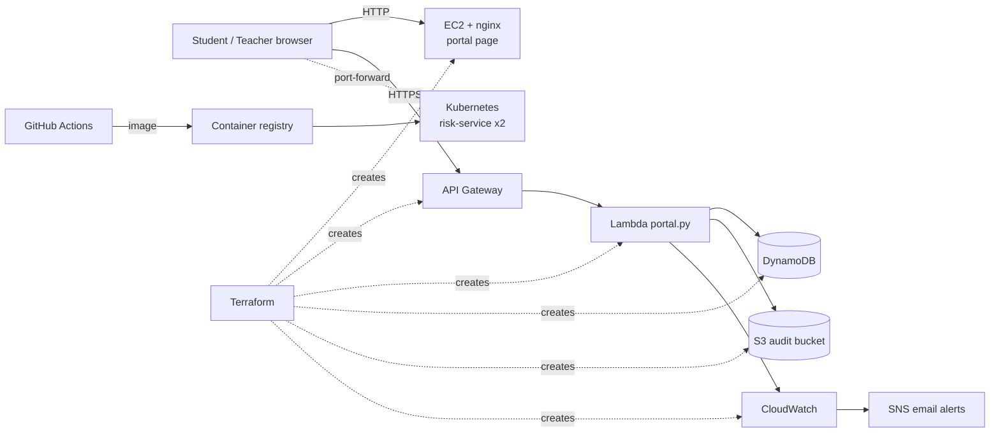

# Architecture Document: Cloud Student Result and Attendance Portal

## 1. System design

## 2. VM setup
| Item | Value |
|---|---|
| Instance | EC2 t3.micro, Amazon Linux 2023 |
| Software | nginx, installed by `user_data` at first boot |
| Content | `frontend/index.html` with the API URL injected by Terraform |
| Disk | Encrypted root volume |
| Firewall | Port 80 open to all, port 22 only from the admin's IP |

## 3. VPC layout
The project uses the account's **default VPC** to stay simple and free.

| Component | Setting |
|---|---|
| VPC | Default VPC (CIDR 172.31.0.0/16) |
| Subnet | Default public subnet, auto-assigned public IP |
| Route | Subnet route table sends 0.0.0.0/0 to the Internet Gateway |
| Security group | `student-portal-web-sg` (rules above) |
| NAT gateway | Not used; the VM is public and the data services (Lambda, DynamoDB, S3) are managed and sit outside the VPC |

Production improvement: custom VPC with public subnet for the web tier and private subnets for data, plus NAT.

## 4. Microservices architecture
| Component | Type | Responsibility |
|---|---|---|
| `portal.py` | Serverless (Lambda) | Attendance, marks, summary, audit log |
| `risk-service` | Container on Kubernetes (2 replicas) | Predicts at-risk probability |

### API
| Route | Auth | Purpose |
|---|---|---|
| `POST /attendance` | Admin key | Save present/absent for a date |
| `POST /results` | Admin key | Save marks (0-100) for a subject |
| `GET /students/{roll}` | None | Attendance %, marks, average, grade, exam eligibility |
| `POST /risk` (risk-service) | None | At-risk probability from attendance % and average marks |

Rules: attendance below 75% means not eligible for exam. Grades: 90 A+, 80 A, 70 B, 60 C, 50 D, else F.

## 5. Data model
One DynamoDB table `student-portal-data` (partition key `roll`, sort key `sk`):

| roll | sk | Attributes |
|---|---|---|
| ECE01 | `ATT#2026-10-01` | status = present / absent |
| ECE01 | `RES#Maths` | marks = 82 |

One query on `roll` returns everything for a student. Every admin write is also saved as a JSON file in S3 under `audit/<date>/`; a lifecycle rule moves files to Glacier after 30 days and deletes them after 365 days.

## 6. Data flow
1. Teacher opens the portal page from EC2 and enters the admin key.
2. Browser calls `POST /attendance` or `POST /results` on API Gateway.
3. Lambda checks the key, validates input, writes to DynamoDB, writes an audit record to S3.
4. Student calls `GET /students/{roll}`; Lambda queries DynamoDB and computes percentage, average, grade, eligibility.
5. The page sends those two numbers to `risk-service`, which returns the risk probability.
6. Logs and metrics go to CloudWatch; alarms email through SNS.

## 7. Security model
| Layer | Control |
|---|---|
| Identity | MFA on root and admin; Lambda role limited to `PutItem` + `Query` on one table and `PutObject` on `audit/*` |
| Application | Admin key (constant-time compare) for writes; input validation; API throttling (10 req/s, burst 20) |
| Network | SSH only from admin IP; S3 public access blocked |
| Encryption at rest | S3 (AES-256), DynamoDB, EBS volume |
| Encryption in transit | API Gateway is HTTPS only |
| Secrets | Admin key is a sensitive Terraform variable, not in Git |
| Audit | Every write recorded in S3 |

Known limits (say these in your viva): the admin key is a shared secret, not per-user login, and the portal page is HTTP. A production version would use Amazon Cognito and CloudFront with HTTPS.

## 8. Virtualization vs containerization
| Aspect | EC2 VM | Docker container |
|---|---|---|
| Start-up | Minutes | Seconds |
| Size | GBs | MBs |
| Isolation | Own guest OS | Shares host kernel |
| Used here for | nginx web server | Risk ML service |

## 9. Monitoring
CloudWatch dashboard (Lambda invocations/errors, DynamoDB writes), alarm on Lambda errors, billing alarm at 5 USD, Lambda logs in CloudWatch Logs, SNS email notifications.

## 10. Automation
Terraform defines every resource. GitHub Actions: test (pytest) → `terraform validate` → Docker build → push to GHCR.

## 11. Big Data and ML summary
The brief lists EMR, Redshift, Kinesis and SageMaker. For a small portal these are overkill, so this project uses a lightweight equivalent: a scikit-learn logistic-regression model (inputs: attendance %, average marks) trained on 3,000 synthetic students, training accuracy 0.89, packaged in Docker and served on Kubernetes. Because the training data is synthetic, treat the model as a demonstration of the deployment pipeline, not a validated predictor.

## 12. No-code app (optional module 8)
In Mendix or OutSystems (free tier): create an app, add a REST consume action pointing at `GET <api_url>/students/{roll}`, build a page with a roll-number input and a table of results, publish, and add the link and a screenshot to your report.
